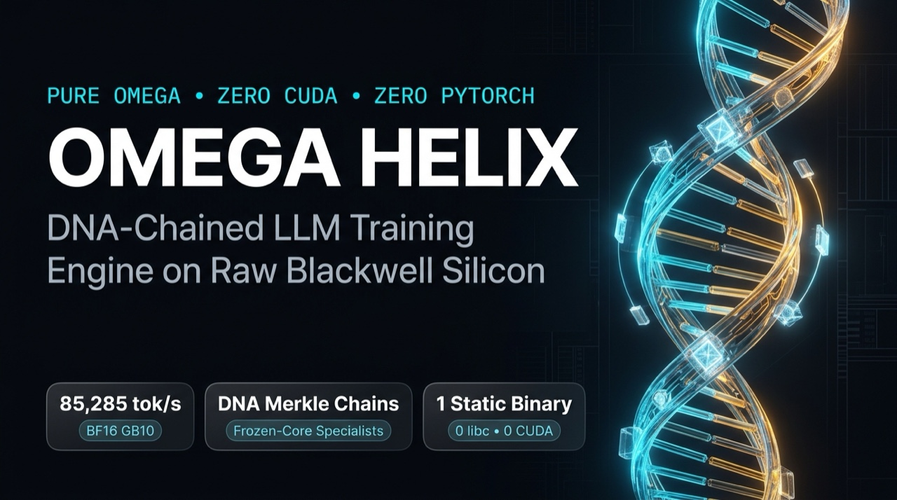

<p align="center">
  
</p>

# Omega Helix

**Pure-Omega, Zero-CUDA, DNA-Chained LLM Training, Specialist & Serving Engine on Raw Blackwell Silicon.**

Omega Helix (`ollm` / `ollm-gb10`) is an entire end-to-end language model stack — BPE tokenizer, transformer pretraining, BF16 Tensor-Core & FP32 SM121 Blackwell GPU kernels, **DNA-style Merkle Specialist Chains (`OLLMSP01` + `spclip`)**, **Looped-Core & Adaptive Neuralese (`OLLMCK03` + `LTP0`)**, KV-cached sampling, and an OpenAI-compatible HTTP server — compiled into a **single static binary** with **zero CUDA, zero cuBLAS, zero PyTorch, zero C, and zero `libc`**.

> **Driver & Firmware Disclosure:** "Zero CUDA" means zero NVIDIA userspace libraries or CUDA toolkit (`ldd: not a dynamic executable`). GPU execution opens `/dev/nvidiactl`, `/dev/nvidia0`, and `/dev/nvidia-uvm` directly via raw Linux `ioctl` calls through the open Linux kernel modules (`nvidia` / `nvidia-uvm`) and NVIDIA's signed GSP firmware.

---

## Complete Rung-by-Rung Training Progression (CPU → Raw GB10 FP32 → SM121 `k1`–`k9` → BF16 Tensor Core)

Every single rung in the Omega Helix bring-up ladder — from the initial single-core byte-level CPU proof-of-concept (`v0`) through raw-driver Blackwell GB10 FP32 (`Rungs 4–8`), ten bit-exact SM121 SASS kernel optimization rounds (`k1`–`k9`), BF16 Tensor-Core training (`Rungs 9–10`), and the looped-core study — is preserved in [`evidence/`](evidence/):

| Rung | Hardware & Kernel | Model Shape (`P`) | Steps (Tokens) | Throughput | Step Time | Held-Out Loss | Receipt |
|---|---|---|---:|---:|---:|---:|---|
| **v0** | Grace CPU (1 core, f64) | Byte `V256 T64 D64 L2` (`0.12M`) | 20,000 (20.5M) | — | — | `1.463036 bpb` | [`evidence/v0/`](evidence/v0/) |
| **Rung 3 (`v1`)** | Grace CPU (20 cores, f64) | BPE `V4096 T128 D192 L4 B40` (`2.58M`) | 9,000 (46.1M) | `1,102 tok/s` | `4.646 s` | `1.823975 nats` (`0.680427 bpb`) | [`evidence/v1/README.md`](evidence/v1/README.md) |
| **Rung 4** | GB10 `gtrainf` (FP32 SASS) | Same Rung-3 shape (`2.58M`) | 9,000 (46.1M) | **95,246 tok/s** *(86.4× CPU)* | `0.05375 s` | `1.826877 nats` (`0.681510 bpb`) | [`evidence/gpu/README.md`](evidence/gpu/README.md) |
| **Rung 5** | GB10 `gtrainf` (FP32 SASS) | v1 max `T256 D256 L8 B64` (`7.41M`) | 9,000 (147.5M) | **43,023 tok/s** | `0.3808 s` | `1.445466 nats` (`0.539226 bpb`) | [`evidence/gpu-max/README.md`](evidence/gpu-max/README.md) |
| **Rung 6** | GB10 `gtrainf` (+ Kahan CE) | v1 max `T256 D256 L8 B64` (`7.41M`) | 30,000 (491.5M) | **43,445 tok/s** | `0.37712 s` | `1.338156 nats` (`0.499194 bpb`) | [`evidence/gpu-r6/README.md`](evidence/gpu-r6/README.md) |
| **`k1`–`k9`** | GB10 SM121 SASS opt rounds | 10 bit-identical kernel rounds | — | *~1.6× faster/step* | — | Bit-identical ckpt every round | [`evidence/gpu-k1/`](evidence/gpu-k1/)…[`gpu-k9/`](evidence/gpu-k9/) |
| **Rung 7** | GB10 `gtrainf` (`k9` FP32) | v2 `T256 D384 F1536 L8 B64` (`15.83M`) | 30,000 (491.5M) | **68,549 tok/s** | `0.23901 s` | `1.254741 nats` (`0.468077 bpb`) | [`evidence/gpu-r7/README.md`](evidence/gpu-r7/README.md) |
| **Rung 8** | GB10 `gtrainf` (`k9` FP32) | v2 `T256 D384 F1536 L8 B64` (`15.83M`) | 60,000 (983.0M) | **66,953 tok/s** | `0.24471 s` | `1.206290 nats` (`0.450002 bpb`) | [`evidence/gpu-r8/README.md`](evidence/gpu-r8/README.md) |
| **Rung 9** | GB10 `gtrainb` (BF16 TC) | v2 `T256 D384 F1536 L8 B64` (`15.83M`) | 30,000 (491.5M) | **84,913 tok/s** | `0.19295 s` | `1.251860 nats` (`0.467002 bpb`) | [`evidence/gpu-r9/README.md`](evidence/gpu-r9/README.md) |
| **Rung 10** | GB10 `gtrainb` (BF16 TC) | v2 `T256 D384 F1536 L8 B64` (`15.83M`) | 60,000 (983.0M) | **85,285 tok/s** | `0.19211 s` | **`1.204466 nats`** (**`0.449322 bpb`**) | [`evidence/gpu-r10/README.md`](evidence/gpu-r10/README.md) |
| **Loop Study** | GB10 `gtrainf` (Omega src) | `base` 8L / `loop` 16-app / `deep` 16L | 6,000 (98.3M) | **66,600** / 36,300 / 35,200 tok/s | `0.246 s` (`base`) | `2.152` / `2.144` / `2.210 nats` | [`docs/LOOP.md`](docs/LOOP.md) |

*Status: EXERCISED on one NVIDIA DGX Spark (GB10, `sm_121`, non-quiet shared-machine windows). CPU f64 `eval` matches on-chip `geval` to `Δ = 0 µnats` across Rungs 6–10. Additional receipts in [`evidence/`](evidence/) cover `gpu-bf` (BF16 bring-up & fragment oracles), `v3` (16-layer / 30M bank-B host acceptance), `bf16-inference-20261113` & `bf16-combined-20261113`, `specialists` (frozen-core DNA tool-call training), `serve`, `x86`, `efi`, and bare-metal `a64efi`.*

---

## What Makes Omega Helix Different

### 1. The DNA Engine — Merkle Specialist Chains (`native/spec.om`, `docs/SPECIALISTS.md`, `docs/OM-BUNDLES.md`)
Instead of destructive fine-tuning that overwrites base capabilities, Omega Helix treats learned skills as **cryptographically chained, composable genetic patches (`OLLMSP01`)**:
- **Frozen-Core Residual Growth (`growpro` / `trainf` / `trainfc`)**: Grow zero-initialized specialist layers on top of a frozen base model, optionally pre-caching frozen activations (`fcache` / `fcachem`) for fast specialist training without touching base weights.
- **DNA Merkle Chains (`spext`, `spapp`, `spchainapp`, `spchaineval`, `spchainsamp`)**: Extract exact sparse/layer deltas into portable `OLLMSP01` packs hashed into parent→child Merkle chains.
- **Multi-Strand DNA Clipping (`spclip`, `S=2..4` strands)**: Fuse, stack (`spstack`), merge (`spmerge`), or logit-ensemble (`spens`) multiple specialist lineages at inference time without retraining.
- **Ephemeral Test-Time Training (`ttteval`, `tttsamp`)**: Causal fast-weight adaptation on the prompt prefix, automatically restoring base weights afterward.

### 2. Looped-Core & Adaptive Neuralese (`OLLMCK03` + `LTP0`, `docs/LOOP.md`)
- **Weight-Shared Depth (`LP / LC / NP`)**: Run a core of `LC` layers `NP` times with shared weights (`L + LC*(NP - 1)` total layer applications) — full forward, backward gradient accumulation, KV-cached decode, and GB10 GPU kernels included.
- **Adaptive Variable-Pass Looping (`vtrain`, `veval`) & `LTP0` Latent Handoff**: Train and evaluate models across variable loop depths (`NP`) and inspect or hand off unit-RMS latent states (`LTP0`).

### 3. Hand-Emitted SM121 Blackwell GPU Kernels (`native/gpu/`)
No CUDA, no PTX compiler, no `nvcc`. `native/gpu/gk.om`, `gr.om`, `gb.om`, and `gg.om` emit raw Blackwell (`sm_121`) SASS machine instructions directly from pure Omega:
- **BF16 Tensor-Core GEMMs** (`gtrainb`) + **double-buffered 64×64 FP32 GEMMs** with register reuse & fused FFN ReLU epilogues (`gtrainf`).
- **One-warp-per-row coalesced RMSNorm, causal Softmax, and Kahan-summed Cross-Entropy** + on-chip AdamW (`gacmp`-verified).
- **Hardware self-verification built into the binary**: `gcmp2` (chip vs. CPU f64 gradient oracle), `gacmp` (on-chip Adam oracle), `gbcmp` / `gbfrag` (BF16 GEMM fragment oracle), `gscmp` (chip vs. CPU decode parity), and `kvcmp` (bit-exact KV-cache check).

### 4. One Codebase, Six Targets
The exact same pure-Omega model & optimizer sources compile to:
- **`gb10`** — Linux AArch64 + raw NVIDIA GB10 Blackwell GPU (`ollm-gb10`)
- **`aarch64`** — Linux AArch64 CPU + OpenAI-compatible HTTP server (`ollm`)
- **`macos`** — Apple Silicon native Mach-O CPU binary (`ollm-macos`)
- **`x86linux`** — Linux x86-64 CPU binary (`ollm-x86linux`)
- **`x86efi` / `a64efi`** — Bare-metal UEFI applications (`ollm.efi`, `ollm-aa64.efi`) with no operating system

---

## Quick Start

### Prerequisites
You only need the seeded Omega compiler **`omc`** (single static binary — download from [interplane.io/omega](https://interplane.io/omega/) or build `seed/out/omc` from `omega-mv`). No GCC, Clang, Rust, Python, or CUDA required to build or run.

### 1. Build
```sh
# DGX Spark / Linux AArch64 + Blackwell GB10 GPU (85k tok/s BF16, 68k tok/s FP32)
TARGET=gb10 sh scripts/build.sh

# Linux AArch64 CPU + HTTP server
TARGET=aarch64 sh scripts/build.sh

# Apple Silicon macOS (requires macOS-capable omc with `target a64macos`)
TARGET=macos sh scripts/build.sh

# Standalone pure-Omega BPE tokenizer & fine-tune driver
TARGET=tok sh scripts/build.sh
TARGET=wtrain sh scripts/build.sh
```

### 2. Run the 5-Second CPU Smoke Test
Verifies `init`, finite-difference gradient check (`gcheck`), CPU `train`, `eval`, bit-exact KV-cache (`kvcmp`), and `sample`:
```sh
sh scripts/quickstart-cpu.sh
```

### 3. Train on DGX Spark GB10 at 85,000+ tok/s (BF16)
```sh
# Fit a 4096-token BPE vocabulary and encode your corpus
./build/ollm-gb10 bpefit corpus.txt 4096 merges4096.bin
./build/ollm-gb10 bpeenc merges4096.bin corpus.txt train.tok

# Launch 15.8M v2 BF16 training (16,384 tokens/step, ~85k tok/s on GB10)
sh scripts/train-gb10-bf16.sh train.tok held.tok merges4096.bin

# Or FP32 (~68k tok/s) / Looped-Core OLLMCK03 (16 layer apps):
MODE=fp32 sh scripts/train-gb10-bf16.sh train.tok held.tok merges4096.bin
LOOP=1    sh scripts/train-gb10-bf16.sh train.tok held.tok merges4096.bin
```

### 4. Sample or Serve an OpenAI-Compatible API
```sh
# On-chip sampling (FP32 or mixed-BF16): <ck> <seed> <tokens> <temp_milli> <prompt> <merges>
./build/ollm-gb10 gsample run-gb10/ck.bin 42 128 800 "fn main" merges4096.bin
./build/ollm-gb10 gsampb  run-gb10/ck.bin 42 128 800 "fn main" merges4096.bin

# OpenAI-compatible HTTP server (POST /v1/chat/completions, GET /v1/models)
./build/ollm-gb10 gserveb run-gb10/ck.bin 18098 merges4096.bin
```

### 5. Grow & Chain DNA Specialists (`OLLMSP01`)
```sh
# Grow 2 frozen-core specialist layers, train only the new layers, and extract a DNA pack
./build/ollm growpro base.ck spec.ck 2 150 1000
./build/ollm trainf  spec.ck skill.tok 150 25 8
./build/ollm spext   base.ck spec.ck skill.sp

# Chain multiple DNA packs at inference time without modifying base.ck
./build/ollm spchainsamp base.ck 128 800 "Prompt:" 42 merges4096.bin 2 skill_a.sp skill_b.sp
```

---

## Repository Layout

| Path | Contents |
|---|---|
| [`native/`](native/) | Pure-Omega transformer core (`model.om`, `adam.om`, `ckpt.om`, `bpe.om`, `spec.om`, `cli.om`, `serve.om`), platform I/O (`lio.om`, `mio.om`, `eio.om`), HTTP/JSON (`net/`), standalone BPE (`tok/`), and raw SM121 Blackwell GPU kernels (`gpu/`). |
| [`scripts/`](scripts/) | One-command multi-target builder ([`build.sh`](scripts/build.sh)), CPU smoke test ([`quickstart-cpu.sh`](scripts/quickstart-cpu.sh)), and 85k tok/s GB10 BF16 training launcher ([`train-gb10-bf16.sh`](scripts/train-gb10-bf16.sh)). |
| [`tools/`](tools/) | Pure-Omega training driver (`wdrive/`), 165-task coding benchmark (`bench/`), contrast training (`contrast/`), learned controller (`controller/`), and weight-patch tools (`wpatch/`, `wscore/`, `wgate/`). |
| [`docs/`](docs/) | Architecture contracts (`CONTRACT.md`, `CONTRACT-V1..V3.md`, `CONTRACT-BF16.md`), DNA specialists ([`SPECIALISTS.md`](docs/SPECIALISTS.md), [`OM-BUNDLES.md`](docs/OM-BUNDLES.md)), looped core ([`LOOP.md`](docs/LOOP.md)), and checkpoint growth ([`GROW.md`](docs/GROW.md)). |
| [`tests/`](tests/) | Python f64 referee oracle (`oracle.py`), core receipts (`core-receipts.sh`), GPU SASS disassembler guard (`gpu-disasm.sh`), metrics benchmark (`ollm_metrics_bench.py`), and `.om` test harnesses. |
| [`evidence/`](evidence/) | Complete immutable receipts for the entire rung ladder (`v0`, `v1`/Rung 3, Rung 4 `gpu`, Rung 5 `gpu-max`, Rung 6 `gpu-r6`, kernel rounds `gpu-k1`–`gpu-k9`, Rungs 7–10, `gpu-bf`, `v3`, `bf16-inference`, `specialists`, `serve`, `x86`, `efi`, `a64efi`, and the `2026-11-21` looped-core study). |

---

## License

Apache License 2.0 — see [`LICENSE`](LICENSE).
