<p align="center">
  
</p>

<p align="center">
  <a href="https://github.com/drakestapleton/omega-helix/actions/workflows/verify.yml"></a>
  <a href="https://github.com/drakestapleton/omega-helix/releases/tag/v0.1.0"></a>
  <a href="LICENSE"></a>
  <a href="https://github.com/drakestapleton/omega-helix/issues/5"></a>
</p>

# Omega Helix

**Pure-Omega, Zero-CUDA, DNA-Chained LLM Training, Specialist & Serving Engine on Raw Blackwell Silicon.**

Omega Helix (`ollm` / `ollm-gb10`) is an entire end-to-end language model stack — BPE tokenizer, transformer pretraining, BF16 Tensor-Core & FP32 SM121 Blackwell GPU kernels, **DNA-style Merkle Specialist Chains (`OLLMSP01` + `spclip`)**, **Looped-Core & Adaptive Neuralese (`OLLMCK03` + `LTP0`)**, KV-cached sampling, and an OpenAI-compatible HTTP server — compiled into a **single static binary** with **zero CUDA, zero cuBLAS, zero PyTorch, zero C, and zero `libc`**.

> **Repo Scope & Language Disclosure:** `omega-helix` is the standalone pure-Omega LLM training, DNA specialist, and serving engine; [`omega-mv`](https://interplane.io/drakestapleton/omega-mv) (`seed/helix/`) holds the bootstrapped `omc` compiler and proof-carrying toolchain. All engine binaries, GPU kernels, tokenizers, and HTTP servers in `native/` are 100% pure Omega (`.om`) with zero Python or C; Python files under `tests/` and `tools/` are strictly the independent `f64` referee oracle (`oracle.py`) and optional local Studio UI/CLI helpers (marked `linguist-vendored` in `.gitattributes`).
>
> **Driver & Firmware Disclosure:** "Zero CUDA" means zero NVIDIA userspace libraries or CUDA toolkit (`ldd: not a dynamic executable`). GPU execution opens `/dev/nvidiactl`, `/dev/nvidia0`, and `/dev/nvidia-uvm` directly via raw Linux `ioctl` calls through the open Linux kernel modules (`nvidia` / `nvidia-uvm`) and NVIDIA's signed GSP firmware.

---

## Verify on Your Own Laptop in 30 Seconds (Zero GPU Required)

Runs cleanly on any Apple Silicon Mac or Linux (`x86_64` / `aarch64`) machine with Python 3 + [`omc`](https://interplane.io/omega/) — compiles the static engine, verifies linkage (`otool -L` / `ldd`), checks bit-exact gradient/step parity against the independent Python `f64` oracle, and trips two live negative controls (`rc=61` on tampered `.sp`, non-zero on injected oracle mutant):

```sh
git clone https://github.com/drakestapleton/omega-helix.git && cd omega-helix
sh scripts/verify-30s.sh
```

---

## 45-Second Uncut Live Proof (Zero CUDA / Static ELF / `/proc/$PID/maps` Empty / Negative Controls)

Recorded unedited on DGX Spark GB10 (`evidence/proof-zero-cuda-gb10/{`[`transcript.txt`](evidence/proof-zero-cuda-gb10/transcript.txt)`,` [`proof.cast`](evidence/proof-zero-cuda-gb10/proof.cast)`}` via [`scripts/record-zero-cuda-proof.sh`](scripts/record-zero-cuda-proof.sh)):

<p align="center">
  
</p>

---

## What's Proven / What's `NOT_RUN` / What Missed

| Area | Status | Honest Scope, Receipts & Boundaries |
|---|---|---|
| **DGX Spark GB10 Silicon (`sm_121`)** | **PROVEN** | Rungs 4–10 (`85,285 tok/s` BF16 `1.204466 nats`), `Δ = 0 µnats` CPU vs. chip `geval`, 43/43 SM121 SASS disassembly guard slots (`tests/gpu-disasm.sh --all`), and raw `/dev/nvidia*` execution with empty CUDA `/proc/$PID/maps` ([`evidence/`](evidence/)). |
| **Independent CPU & Oracle Verification** | **PROVEN** | Full `scripts/verify.sh` (`adamck`, `gcheck`, `kvcmp`, `oracle.py`, `oracle_universal.py`, Safetensors/GGUF `test_interchange.py`, `test_adaptive_loop.py`, Studio/Distill/Runtime/Commons suites, `verify-30s.sh`) verified on Apple Silicon macOS + DGX Spark AArch64 + GitHub Actions CI. |
| **QEMU-Emulated Bare-Metal Targets** | **EMULATED ONLY** | `x86efi` (QEMU + OVMF) & `a64efi` (QEMU + KVM + AAVMF) executed `.sp` DNA chains; `a64efi` also booted on physical Spark UEFI (`evidence/OMEGALLM/a64efi/dgx-spark/`). **Physical bare-metal x86 UEFI remains `NOT_RUN`.** |
| **CPU-Only Feature Paths (`NOT_RUN` on GB10)** | **CPU ONLY (`GPU NOT_RUN`)** | Per-token adaptive loop exit & inter-pass messages (`adapteval`/`adaptsamp`/`adaptcmp`), grammar FSM `gsamp`, and `ollm spguard` JSD + anti-DNA steering run on CPU only (`docs/LOOP.md`, `docs/SOVEREIGN-RUNTIME.md`); `FREEZE_LAYERS` + fixed-`NP` looped `gtrainf`/`gtrainb` ARE proven on GB10. |
| **Scratch 15.8M Coding-Bench Miss** | **MISSED (`0 / 159`)** | All three arms (`base`, `loop`, `deep`) trained for 6,000 steps on the small `.om` repo corpus scored **`0 of 159`** on `tools/bench/` Python/coding tasks (`docs/LOOP.md` — small scratch corpus capacity/token-budget miss). |
| **Trust & Hardware Boundaries** | **DISCLOSED** | Open `nvidia` / `nvidia-uvm` kernel modules + NVIDIA signed GSP firmware sit beneath raw `ioctl` submission; hardware receipts so far come from **one operator's DGX Spark + MacBook** alongside automated GitHub Actions CPU runners. |

---

## Reproducible Head-to-Head: Omega Helix vs. PyTorch + CUDA (`15.83M` Model on DGX Spark GB10)

Matched model (`V=4096, T=256, D=384, H=12, F=1536, L=8, B=64`, `15,833,472` params, RMSNorm, causal attention, ReLU MLP, tied head, BF16 + AdamW) run inside the same exclusive GB10 window ([`evidence/h2h-pytorch-gb10/README.md`](evidence/h2h-pytorch-gb10/README.md), [`tests/bench_pytorch_h2h.py`](tests/bench_pytorch_h2h.py)):

| Metric | Omega Helix (`ollm-gb10 gtrainb`) | PyTorch `2.14.0+cu130` (Eager) | PyTorch `2.14.0+cu130` (`torch.compile`) |
|---|---:|---:|---:|
| **Install / Binary Footprint** | **`791,988 B` (~773 KiB)** | `5,325,112,578 B` (~4.96 GiB) | `5,325,112,578 B` (~4.96 GiB) |
| **Userspace CUDA / cuBLAS / Triton** | **0 (static ELF, `not a dynamic executable`)** | Yes (`cu130`, cuBLAS, cuDNN) | Yes (`cu130`, Triton 3.8, Inductor) |
| **Cold Start to Step 1** | `7,258.3 ms` *(loads & saves `380 MB` `f64` ckpt)* | **`2,646.8 ms`** *(in-RAM init)* | `4,748.5 ms` *(in-RAM + compile)* |
| **Steady-State Speed (30 steps)** | `84,646.7 tok/s` (`193.56 ms/step`) | **`130,769.2 tok/s`** (`125.29 ms`) | **`257,463.6 tok/s`** (`63.64 ms`) |
| **Peak CUDA Alloc / Reserved** | Raw `/dev/nvidia*` UVM heaps (zero CUDA) | `2.08 GiB` / `2.21 GiB` | `1.65 GiB` / `2.21 GiB` |

---

## Independent Reproducers Log

> **Want to add your hardware?** Run `sh scripts/verify.sh 2>&1 | tee verify.log` (or `sh scripts/verify-30s.sh`) and post your log SHA-256 in the pinned issue: [**#5 — Run `scripts/verify.sh` on your machine and post your receipt**](https://github.com/drakestapleton/omega-helix/issues/5).

| Date (UTC) | GitHub Handle / CI | Machine / OS | Command | Receipt / Binary SHA-256 |
|---|---|---|---|---|
| 2026-11-25 | [`github-actions`](https://github.com/drakestapleton/omega-helix/actions/workflows/verify.yml) | Ubuntu x86_64 / ARM64 & macOS arm64 | `sh scripts/verify.sh` | Live workflow artifact (`verify-ci-*.log`) |
| 2026-11-25 | `@drakestapleton` | Apple Silicon macOS arm64 (M2 Air) | `sh scripts/verify-30s.sh` | Binary `c8c03d85955653ae...` (static Mach-O, `VERIFY_30S_PASS`) |
| 2026-11-25 | `@drakestapleton` | NVIDIA DGX Spark (Grace + GB10 `sm_121`) | `sh scripts/verify.sh` + `record-zero-cuda-proof.sh` | See [`evidence/proof-zero-cuda-gb10/SHA256SUMS.txt`](evidence/proof-zero-cuda-gb10/SHA256SUMS.txt) |

---

## Complete Rung-by-Rung Training Progression (CPU → Raw GB10 FP32 → SM121 `k1`–`k9` → BF16 Tensor Core)

Every single rung in the Omega Helix bring-up ladder — from the initial single-core byte-level CPU proof-of-concept (`v0`) through raw-driver Blackwell GB10 FP32 (`Rungs 4–8`), ten bit-exact SM121 SASS kernel optimization rounds (`k1`–`k9`), BF16 Tensor-Core training (`Rungs 9–10`), and the looped-core study — is preserved in [`evidence/`](evidence/):

| Rung | Hardware & Kernel | Model Shape (`P`) | Steps (Tokens) | Throughput | Step Time | Held-Out Loss | Receipt |
|---|---|---|---:|---:|---:|---:|---|
| **v0** | Grace CPU (1 core, f64) | Byte `V256 T64 D64 L2` (`0.12M`) | 20,000 (20.5M) | — | — | `1.463036 bpb` | [`evidence/v0/`](evidence/v0/) |
| **Rung 3 (`v1`)** | Grace CPU (20 cores, f64) | BPE `V4096 T128 D192 L4 B40` (`2.58M`) | 9,000 (46.1M) | `1,102 tok/s` | `4.646 s` | `1.823975 nats` (`0.680427 bpb`) | [`evidence/v1/README.md`](evidence/v1/README.md) |
| **Rung 4** | GB10 `gtrainf` (FP32 SASS) | Same Rung-3 shape (`2.58M`) | 9,000 (46.1M) | **95,246 tok/s** *(86.4× CPU)* | `0.05375 s` | `1.826877 nats` (`0.681510 bpb`) | [`evidence/gpu/README.md`](evidence/gpu/README.md) |
| **Rung 5** | GB10 `gtrainf` (FP32 SASS) | v1 max `T256 D256 L8 B64` (`7.41M`) | 9,000 (147.5M) | **43,023 tok/s** | `0.3808 s` | `1.445466 nats` (`0.539226 bpb`) | [`evidence/gpu-max/README.md`](evidence/gpu-max/README.md) |
| **Rung 6** | GB10 `gtrainf` (+ Kahan CE) | v1 max `T256 D256 L8 B64` (`7.41M`) | 30,000 (491.5M) | **43,445 tok/s** | `0.37712 s` | `1.338156 nats` (`0.499194 bpb`) | [`evidence/gpu-r6/README.md`](evidence/gpu-r6/README.md) |
| **`k1`–`k9`** | GB10 SM121 SASS opt rounds | 10 bit-identical kernel rounds | — | *~1.6× faster/step* | — | Bit-identical ckpt every round | [`evidence/gpu-k1/`](evidence/gpu-k1/)…[`gpu-k9/`](evidence/gpu-k9/) |
| **Rung 7** | GB10 `gtrainf` (`k9` FP32) | v2 `T256 D384 F1536 L8 B64` (`15.83M`) | 30,000 (491.5M) | **68,549 tok/s** | `0.23901 s` | `1.254741 nats` (`0.468077 bpb`) | [`evidence/gpu-r7/README.md`](evidence/gpu-r7/README.md) |
| **Rung 8** | GB10 `gtrainf` (`k9` FP32) | v2 `T256 D384 F1536 L8 B64` (`15.83M`) | 60,000 (983.0M) | **66,953 tok/s** | `0.24471 s` | `1.206290 nats` (`0.450002 bpb`) | [`evidence/gpu-r8/README.md`](evidence/gpu-r8/README.md) |
| **Rung 9** | GB10 `gtrainb` (BF16 TC) | v2 `T256 D384 F1536 L8 B64` (`15.83M`) | 30,000 (491.5M) | **84,913 tok/s** | `0.19295 s` | `1.251860 nats` (`0.467002 bpb`) | [`evidence/gpu-r9/README.md`](evidence/gpu-r9/README.md) |
| **Rung 10** | GB10 `gtrainb` (BF16 TC) | v2 `T256 D384 F1536 L8 B64` (`15.83M`) | 60,000 (983.0M) | **85,285 tok/s** | `0.19211 s` | **`1.204466 nats`** (**`0.449322 bpb`**) | [`evidence/gpu-r10/README.md`](evidence/gpu-r10/README.md) |
| **Loop Study** | GB10 `gtrainf` (Omega src) | `base` 8L / `loop` 16-app / `deep` 16L | 6,000 (98.3M) | **66,600** / 36,300 / 35,200 tok/s | `0.246 s` (`base`) | `2.152` / `2.144` / `2.210 nats` | [`docs/LOOP.md`](docs/LOOP.md) |

*Status: EXERCISED on one NVIDIA DGX Spark (GB10, `sm_121`, non-quiet shared-machine windows). CPU f64 `eval` matches on-chip `geval` to `Δ = 0 µnats` across Rungs 6–10. Additional receipts in [`evidence/`](evidence/) cover `gpu-bf` (BF16 bring-up & fragment oracles), `v3` (16-layer / 30M bank-B host acceptance), `bf16-inference-20261113` & `bf16-combined-20261113`, `specialists` (frozen-core DNA tool-call training), `serve`, `x86`, `efi`, and bare-metal `a64efi`.*

---

## What Makes Omega Helix Different

### 1. The DNA Engine — Merkle Specialist Chains (`native/spec.om`, `docs/SPECIALISTS.md`, `docs/OM-BUNDLES.md`)
Instead of destructive fine-tuning that overwrites base capabilities, Omega Helix treats learned skills as **cryptographically chained, composable genetic patches (`OLLMSP01`)**:
- **Frozen-Core Residual Growth (`growpro` / `trainf` / `trainfc`)**: Grow zero-initialized specialist layers on top of a frozen base model, optionally pre-caching frozen activations (`fcache` / `fcachem`) for fast specialist training without touching base weights.
- **DNA Merkle Chains (`spext`, `spapp`, `spchainapp`, `spchaineval`, `spchainsamp`)**: Extract exact sparse/layer deltas into portable `OLLMSP01` packs hashed into parent→child Merkle chains.
- **Multi-Strand DNA Clipping (`spclip`, `S=2..4` strands)**: Fuse, stack (`spstack`), merge (`spmerge`), or logit-ensemble (`spens`) multiple specialist lineages at inference time without retraining.
- **Ephemeral Test-Time Training (`ttteval`, `tttsamp`)**: Causal fast-weight adaptation on the prompt prefix, automatically restoring base weights afterward.

### 2. Looped-Core & Adaptive Neuralese (`OLLMCK03` + `LTP0`, `docs/LOOP.md`)
- **Weight-Shared Depth (`LP / LC / NP`)**: Run a core of `LC` layers `NP` times with shared weights (`L + LC*(NP - 1)` total layer applications) — full forward, backward gradient accumulation, KV-cached decode, and GB10 GPU kernels included.
- **Adaptive Variable-Pass Looping (`vtrain`, `veval`) & `LTP0` Latent Handoff**: Train and evaluate models across variable loop depths (`NP`) and inspect or hand off unit-RMS latent states (`LTP0`).

### 3. Hand-Emitted SM121 Blackwell GPU Kernels (`native/gpu/`)
No CUDA, no PTX compiler, no `nvcc`. `native/gpu/gk.om`, `gr.om`, `gb.om`, and `gg.om` emit raw Blackwell (`sm_121`) SASS machine instructions directly from pure Omega:
- **BF16 Tensor-Core GEMMs** (`gtrainb`) + **double-buffered 64×64 FP32 GEMMs** with register reuse & fused FFN ReLU epilogues (`gtrainf`).
- **One-warp-per-row coalesced RMSNorm, causal Softmax, and Kahan-summed Cross-Entropy** + on-chip AdamW (`gacmp`-verified).
- **Hardware self-verification built into the binary**: `gcmp2` (chip vs. CPU f64 gradient oracle), `gacmp` (on-chip Adam oracle), `gbcmp` / `gbfrag` (BF16 GEMM fragment oracle), `gscmp` (chip vs. CPU decode parity), and `kvcmp` (bit-exact KV-cache check).

### 4. One Codebase, Six Targets
The exact same pure-Omega model & optimizer sources compile to:
- **`gb10`** — Linux AArch64 + raw NVIDIA GB10 Blackwell GPU (`ollm-gb10`)
- **`aarch64`** — Linux AArch64 CPU + OpenAI-compatible HTTP server (`ollm`)
- **`macos`** — Apple Silicon native Mach-O CPU binary (`ollm-macos`)
- **`x86linux`** — Linux x86-64 CPU binary (`ollm-x86linux`)
- **`x86efi` / `a64efi`** — Bare-metal UEFI applications (`ollm.efi`, `ollm-aa64.efi`) with no operating system

---

## Quick Start

### Prerequisites & One-Command Install (`macOS` Apple Silicon, `DGX Spark`, `Linux`)
You only need Python 3 (built in on macOS/Linux) and the seeded Omega compiler **`omc`** (single static binary — on macOS: `brew tap drakestapleton/omega https://interplane.io/drakestapleton/homebrew-omega.git && brew install drakestapleton/omega/omc`, or see [interplane.io/omega](https://interplane.io/omega/)). Zero GCC, Clang, Rust, or CUDA required.

```sh
git clone https://github.com/drakestapleton/omega-helix.git
cd omega-helix
sh install.sh        # builds all pure-Omega engines for your OS/GPU into ~/.local/opt/omega-helix
omega-helix          # launches Omega Helix Studio in your browser (http://127.0.0.1:18420)
```

With **`omega-helix`** installed, you can visually or via CLI:
- **Search all 73+ OpenWALDO corpora** (`omega-helix catalog --search python`) or load any local folder of files (automatically wrapped into a SHA-256 verified OpenWALDO `EXPORT.json`).
- **Design Custom DNA Helix Chains** interactively (`Base Trunk -> growpro / FREEZE_LAYERS -> Strand A/B/C/D -> spext -> OLLMSP01 -> spclip`) OR universal architectures (`Llama`, `Qwen3`, `Gemma`, `GPT`, `Looped Core`).
- **Forge live with SSE telemetry, interactive playground & one-click HF Safetensors / GGUF v3 exports** (`omega-helix setup` for interactive terminal mode, `omega-helix doctor` to inspect binaries & GPU).

### 1. Build Manual Targets (`scripts/build.sh`)
```sh
# DGX Spark / Linux AArch64 + Blackwell GB10 GPU (85k tok/s BF16, 68k tok/s FP32)
TARGET=gb10 sh scripts/build.sh

# Linux AArch64 CPU + HTTP server
TARGET=aarch64 sh scripts/build.sh

# Apple Silicon macOS (requires macOS-capable omc with `target a64macos`)
TARGET=macos sh scripts/build.sh

# Standalone pure-Omega BPE tokenizer, fine-tune driver & OpenWALDO ingestor
TARGET=tok       sh scripts/build.sh
TARGET=wtrain    sh scripts/build.sh
TARGET=openwaldo sh scripts/build.sh
```

### 2. Run the Verification Suite & CPU Smoke Test
Verifies `adamck`, `init`, finite-difference gradient check (`gcheck`), CPU `train`, `eval`, `sample`, BPE roundtrip, bit-exact KV-cache (`kvcmp`), DNA specialist chaining (`growpro`/`trainf`/`spext`/`spchainsamp`), looped-core `OLLMCK03`, Python f64 oracle cross-checks, OpenWALDO BOM negative controls, and (on Linux AArch64) 165-task benchmark, contrast/controller replays, 43-slot SM121 SASS disassembly, and Lean 4 proofs:
```sh
sh scripts/quickstart-cpu.sh   # 5-second CPU smoke test
sh scripts/verify.sh           # full host-verifiable gate (no GPU required)
```

### 3. Train on DGX Spark GB10 at 85,000+ tok/s (BF16)
```sh
# Fit a 4096-token BPE vocabulary and encode your corpus
./build/ollm-gb10 bpefit corpus.txt merges4096.bin 4096
./build/ollm-gb10 bpeenc merges4096.bin 4096 corpus.txt train.tok

# Launch 15.8M v2 BF16 training (16,384 tokens/step, ~85k tok/s on GB10)
sh scripts/train-gb10-bf16.sh train.tok held.tok merges4096.bin

# Or FP32 (~68k tok/s) / Looped-Core OLLMCK03 (16 layer apps):
MODE=fp32 sh scripts/train-gb10-bf16.sh train.tok held.tok merges4096.bin
LOOP=1    sh scripts/train-gb10-bf16.sh train.tok held.tok merges4096.bin
```

### 4. Sample or Serve an OpenAI-Compatible API
```sh
# On-chip sampling (FP32 or mixed-BF16): <ck> <seed> <tokens> <temp_milli> <prompt> <merges>
./build/ollm-gb10 gsample run-gb10/ck.bin 42 128 800 "fn main" merges4096.bin
./build/ollm-gb10 gsampb  run-gb10/ck.bin 42 128 800 "fn main" merges4096.bin

# OpenAI-compatible HTTP server (POST /v1/chat/completions, GET /v1/models): <port> <ck> <merges>
./build/ollm-gb10 gserveb 18098 run-gb10/ck.bin merges4096.bin
```

### 5. Grow & Chain DNA Specialists (`OLLMSP01`)
```sh
# Expand an 8-layer base to 10 layers (2 frozen-core specialist layers), train only layers 8..9, and extract a DNA pack
./build/ollm growpro base.ck spec.ck 10 150 1000
./build/ollm trainf  spec.ck skill.tok 150 25 8
./build/ollm spext   base.ck spec.ck skill.sp

# Chain multiple DNA packs at inference time without modifying base.ck
./build/ollm spchainsamp base.ck 128 800 "Prompt:" 42 merges4096.bin 2 skill_a.sp skill_b.sp
```

### 6. Train on Open-Source OpenWALDO Datasets with Provenance BOMs
Omega Helix connects to [OpenWALDO](https://github.com/openwaldo/waldo) (`waldo index export --format jsonl`) via fail-closed `EXPORT.json` SHA-256 verification and a pure-Omega JSONL ingestor (`ollm-waldo`), producing an `openwaldo-helix-bom.json` linking source shards and licenses to trained checkpoints — see [`docs/OPENWALDO.md`](docs/OPENWALDO.md):
```sh
waldo index export --format jsonl core/example ./waldo-export
sh scripts/openwaldo-train.sh ./waldo-export ./run-waldo
```

### 7. Sovereign Distillation Pipeline Network (`OLLMDK01`)
Distill traces, logs, and open-source models into compact Helix students (`dk-univ`, `seq-univ`, or Merkle `dna-strand`) with fail-closed verifiers (`omc_compile`, `python_ast`, `json_schema`, `regex`, `nonempty`), multi-teacher routing, Studio Tab 5, and pure seeded-Omega sparse top-K hybrid CE+KL optimization (`ollm-univ dkemit` / `dcheck` / `dtrain`) — see [`docs/DISTILLATION.md`](docs/DISTILLATION.md):
```sh
./bin/omega-helix distill probe
./bin/omega-helix distill harvest -i ./traces.jsonl -o ./distilled-export --verify nonempty,json_schema
./bin/omega-helix distill run --mode dk-univ --arch qwen3 --trace ./traces.jsonl --K 8 --alpha 0.7 --steps 20
```

### 8. Sovereign Runtime: Anti-DNA Firewalls, Disagreement Deep-Thinking & Grammar Decoding
Run negative-weight contrastive Anti-DNA strands with per-token FNV-1a cryptographic receipts + JSD disagreement `LTP0` extra passes (`ollm spguard`), deterministic FSM JSON grammar masking (`ollm-univ gsamp`), verifier-gated sleep cycles (`omega-helix sleep`), compile-until-green crystallization (`omega-helix green`), and the 10-second `import-hf` -> DNA demo (`sh scripts/demo-10s-wow.sh`) — see [`docs/SOVEREIGN-RUNTIME.md`](docs/SOVEREIGN-RUNTIME.md).

### 9. Sovereign Commons, Trust Audit, Memory Migration, Porting Kit & USB-Stick Air-Gap
Manage trunk-pinned ~14 MB `OLLMSP01` `.sp` packages (`omega-helix pkg`), run one-command offline binary/CSP/BOM/Merkle audits (`omega-helix verify`), migrate encrypted personal memory across new model trunks (`omega-helix memory migrate`), certify new silicon backends (`omega-helix port-check`), enforce BFT swarm receipts + revocable agent leases (`omega-helix lease`), and bundle everything for offline air-gapped USB deployment (`omega-helix pack-usb`) — see [`docs/COMMONS.md`](docs/COMMONS.md) and [`docs/BACKEND-PORTING-KIT.md`](docs/BACKEND-PORTING-KIT.md).

---

## Universal Model Engine, Weight Interchange & Open-Source Data

Omega Helix supports **any decoder-only Transformer architecture and parameter scale** with zero static array limits via the pure seeded-Omega universal engine (`ollm-univ`, [`docs/CONTRACT-V4.md`](docs/CONTRACT-V4.md)):

- **Zero static caps (`TARGET=univ`, `native/univ/`):** Dynamic `enlarge` arenas support arbitrary `V, T, D, H, H_kv, F, L, B`, `u8` (`V<=256`), `u16` (`V<=65535`), and `u32` (`V>65535`, e.g. `128K–152K` vocabularies), verified by an independent `f64` oracle (`tests/oracle_universal.py`, max relative error `<= 7.47e-13`).
- **Modern architecture presets & custom bitmasks (`OLLMCK04`):** `llama`, `mistral`, `qwen2`, `qwen3` (`QK-RMSNorm`), `gemma` (`GeGLU` + tied `embed*sqrt(D)` / `1+w` norms), `gpt` (`WPE` + `ReLU`), `gelu`, RoPE / GQA / MQA / SwiGLU / GeGLU / AdamW + Cosine LR, and looped cores (`LP / LC / NP`).
- **Pure-Omega Safetensors & GGUF v3 Interchange (`TARGET=interchange`, `native/univ/interchange.om`):** Import HuggingFace `config.json` + `.safetensors` (`F32`/`BF16`/`F16`/`F64`), export HuggingFace Safetensors (`f32`/`bf16`) and GGUF v3, and upgrade legacy `OLLMCK01/02/03` checkpoints to `OLLMCK04` with zero C/Python/Rust in the binary (`tests/test_interchange.py`).
- **OpenWALDO Open-Source Training Backend (`tools/openwaldo/omega_helix_backend.py`):** End-to-end audited training pipeline from `EXPORT.json` through `ollm-waldo`, BPE/`byte`/`u32` tokenization, any `ollm-univ` architecture (or imported HF Safetensors), Safetensors/GGUF export, and cryptographic `openwaldo-helix-bom.json` + observation bundles (`docs/OPENWALDO.md`).
- **GB10 GPU Frozen-Core Specialists, Looped BF16 & Adaptive Loop Exit:** `gtrainf`/`gtrainb`/`gcmp`/`gacmp` support optional `FREEZE_LAYERS` on GB10 (`grow`/`growpro` -> GPU -> `spext`/`spapp`), `ggks` split-K fixes small-shape/looped BF16 (`gbcmp2` per-tensor cosine check), and CPU looped models support per-token loop exit + deterministic inter-pass messages (`adapteval`/`adaptsamp`/`adaptcmp`, `LTP0` `/v1/neuralese/trace`).

### Quick Example (Universal + Interchange)
```sh
TARGET=univ        sh scripts/build.sh
TARGET=interchange sh scripts/build.sh

# Initialize & train any architecture with zero shape caps (e.g. qwen3, llama, gemma, looped core)
./build/ollm-univ init ck4.bin qwen3 32000 1024 512 8 2 1408 8 4 42 1000 3000
./build/ollm-univ train ck4.bin train.tok 100 25

# Export HuggingFace Safetensors (BF16) and GGUF v3 purely in Omega
mkdir -p hf-out
./build/ollm-interchange export-hf ck4.bin hf-out bf16
./build/ollm-interchange export-gguf ck4.bin model.gguf
```

---

## Repository Layout

| Path | Contents |
|---|---|
| [`install.sh`](install.sh) / [`bin/`](bin/) | One-command cross-platform installer (`install.sh`) and `omega-helix` CLI launcher (`studio`, `setup`, `catalog`, `forge`, `sample`, `doctor`). |
| [`native/`](native/) | Pure-Omega transformer core (`model.om`, `adam.om`, `ckpt.om`, `bpe.om`, `spec.om`, `cli.om`, `serve.om`), universal zero-cap engine & HF/GGUF interchange (`univ/`), platform I/O (`lio.om`, `mio.om`, `eio.om`), HTTP/JSON (`net/`), standalone BPE (`tok/`), and raw SM121 Blackwell GPU kernels (`gpu/`). |
| [`scripts/`](scripts/) | One-command multi-target builder ([`build.sh`](scripts/build.sh)), independent verification suite ([`verify.sh`](scripts/verify.sh)), CPU smoke test ([`quickstart-cpu.sh`](scripts/quickstart-cpu.sh)), OpenWALDO pipeline ([`openwaldo-train.sh`](scripts/openwaldo-train.sh)), and 85k tok/s GB10 BF16 training launcher ([`train-gb10-bf16.sh`](scripts/train-gb10-bf16.sh)). |
| [`tools/`](tools/) | Omega Helix Studio local web app & OpenWALDO directory search (`studio/`), OpenWALDO pure-Omega ingestor, BOM bridge & multi-arch training backend (`openwaldo/`), pure-Omega training driver (`wdrive/`), 165-task coding benchmark (`bench/`), contrast training (`contrast/`), learned controller (`controller/`), and weight-patch tools (`wpatch/`, `wscore/`, `wgate/`). |
| [`docs/`](docs/) | Architecture contracts (`CONTRACT.md`, `CONTRACT-V1..V4.md`, `CONTRACT-BF16.md`), OpenWALDO integration ([`OPENWALDO.md`](docs/OPENWALDO.md)), DNA specialists ([`SPECIALISTS.md`](docs/SPECIALISTS.md), [`OM-BUNDLES.md`](docs/OM-BUNDLES.md)), looped core & adaptive exit ([`LOOP.md`](docs/LOOP.md)), and checkpoint growth ([`GROW.md`](docs/GROW.md)). |
| [`tests/`](tests/) | Python `f64` referee oracles (`oracle.py`, `oracle_universal.py`), HF/GGUF interchange tests (`test_interchange.py`), adaptive loop suite (`test_adaptive_loop.py`), GB10 frozen-core & BF16 loop suite (`test_gpu_spec_loop.sh`), core receipts (`core-receipts.sh`), GPU SASS guard (`gpu-disasm.sh`), and metrics benchmark (`ollm_metrics_bench.py`). |
| [`evidence/`](evidence/) | Complete immutable receipts for the entire rung ladder (`v0`, `v1`/Rung 3, Rung 4 `gpu`, Rung 5 `gpu-max`, Rung 6 `gpu-r6`, kernel rounds `gpu-k1`–`gpu-k9`, Rungs 7–10, `gpu-bf`, `v3`, `bf16-inference`, `specialists`, `serve`, `x86`, `efi`, `a64efi`, and the `2026-11-21` looped-core study). |

---

## License

Apache License 2.0 — see [`LICENSE`](LICENSE).
